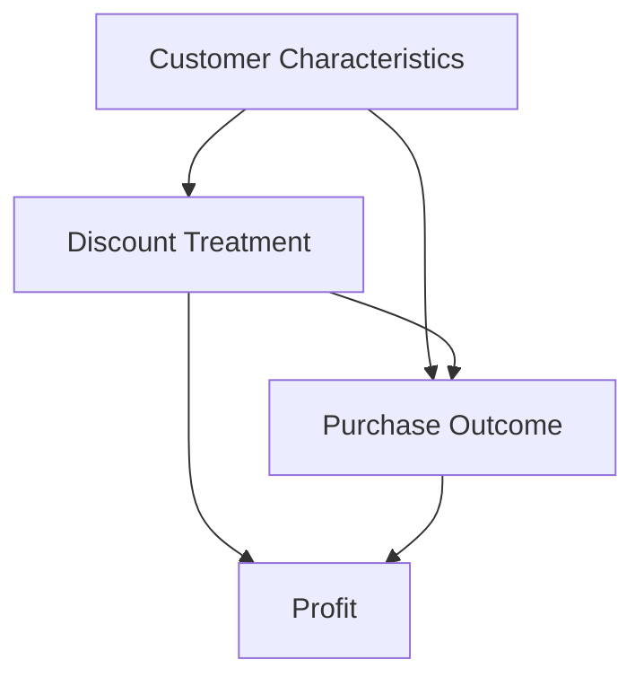

# Causal DAG for EconoCausal

## 1. Purpose

The causal Directed Acyclic Graph (DAG) represents the hypothesised relationships between discount assignment, customer characteristics, purchase behaviour, and profit.

## 2. Proposed Variables

- **X — Customer characteristics:** Age, income, previous purchases, and other available customer attributes.
- **T — Discount treatment:** The discount assigned to a customer.
- **Y — Purchase outcome:** A defined outcome such as purchase probability or revenue.
- **P — Profit:** The business outcome used to compare pricing policies, calculated using documented cost assumptions.

## 3. Proposed Causal Relationships

The initial hypothesis is:

- Customer characteristics may influence discount assignment.
- Customer characteristics may influence purchase behaviour.
- Discount assignment may influence purchase behaviour.
- Purchase behaviour and discount level may influence profit.

These relationships are hypotheses to investigate, not confirmed causal findings.

## 4. DAG Representation

## 5. Relevance to Double Machine Learning

The proposed graph helps identify observed variables that may confound the relationship between discount treatment and purchase outcomes.

The DML analysis will use appropriate observed covariates to estimate treatment effects. The validity of the estimates depends on the quality of the data and the causal assumptions.

## 6. Limitations

The graph represents an initial causal hypothesis. The actual variables and relationships must be checked against the available dataset and the business process. Unobserved confounding may remain even after adjusting for measured covariates.

## 7. Next Steps

- Verify which customer characteristics exist in the dataset.
- Confirm how discount treatment is assigned.
- Define the purchase outcome and profit calculation.
- Review the DAG before fitting the causal model.
